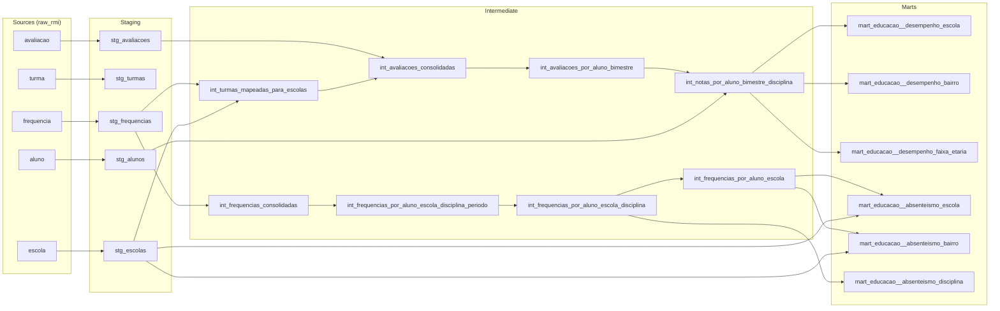

# Desafio RMI — Cientista de Dados

## 1. Apresentação

Este repositório apresenta minha solução para o desafio técnico proposto. Mais do que simplesmente focar em disponibilizar dados prontos para consumo, busquei desenvolver uma modelagem de dados em dbt, seguindo boas práticas e documentando as decisões tomadas ao longo do processo.

Com o objetivo de aproximar o exercício de um cenário real de trabalho, procurei explorar ao máximo as tabelas fornecidas, estruturando um fluxo de transformação de dados que permitisse, ao final, construir indicadores (ainda que fictícios) relevantes para gestores públicos e para a sociedade civil. A proposta foi, portanto, não apenas atender aos requisitos técnicos do desafio, mas também demonstrar como uma modelagem bem estruturada deve se preocupar com a transparência e o monitoramento dos fluxos.

O projeto foi estruturado em quatro camadas de transformação de dados: **raw (source) → staging → intermediate → marts**, seguindo as boas práticas de modelagem em dbt. O enunciado original está disponível em [ENUNCIADO.md](ENUNCIADO.md), a análise dos resultados em [docs/relatorio-resultados.html](https://gabrielribeirobizerril.github.io/desafio-cientista-dados-peqc/relatorio-resultados.html) e a análise exploratória em [notebooks/i_eda.ipynb](notebooks/i_eda.ipynb). A documentação mais pormenorizada de cada modelo, com descrição das colunas, testes e linhagem, pode ser encontrada no [dbt docs](https://gabrielribeirobizerril.github.io/desafio-cientista-dados-peqc/) e no [BigQuery](https://console.cloud.google.com/bigquery?project=desafio-cientista-dados-peqc), onde as mesmas descrições ficam gravadas em cada tabela e coluna.

Um dos princípios centrais da arquitetura foi **definir cada regra de negócio uma única vez**, seja em uma macro ou em um modelo específico, evitando duplicações e garantindo sua reutilização nas etapas seguintes. Essa abordagem facilita a manutenção do código, assegura a consistência das transformações e permite que os testes de reconciliação verifiquem, a cada execução, se os totais permanecem coerentes entre as camadas e se os indicadores de uma mesma família são calculados a partir de uma base comum.

### Estrutura do projeto

```
├── models/
│   ├── staging/educacao/                      1 modelo por tabela da fonte
│   │   ├── sources.yml                        fontes raw_rmi, com descrição e testes da origem
│   │   ├── schema.yml
│   │   ├── stg_educacao__alunos.sql
│   │   ├── stg_educacao__avaliacoes.sql
│   │   ├── stg_educacao__escolas.sql
│   │   ├── stg_educacao__frequencias.sql
│   │   └── stg_educacao__turmas.sql
│   ├── intermediate/
│   │   ├── schema.yml
│   │   ├── int_turmas_mapeadas_para_escolas.sql
│   │   ├── int_avaliacoes_consolidadas.sql
│   │   ├── int_avaliacoes_por_aluno_bimestre.sql
│   │   ├── int_notas_por_aluno_bimestre_disciplina.sql
│   │   ├── int_frequencias_consolidadas.sql
│   │   ├── int_frequencias_por_aluno_escola_disciplina_periodo.sql
│   │   ├── int_frequencias_por_aluno_escola_disciplina.sql
│   │   └── int_frequencias_por_aluno_escola.sql
│   ├── marts/                                 tabelas com contrato
│   │   ├── schema.yml
│   │   ├── mart_educacao__absenteismo_escola.sql
│   │   ├── mart_educacao__absenteismo_bairro.sql
│   │   ├── mart_educacao__absenteismo_disciplina.sql
│   │   ├── mart_educacao__desempenho_escola.sql
│   │   ├── mart_educacao__desempenho_bairro.sql
│   │   └── mart_educacao__desempenho_faixa_etaria.sql
│   ├── exposures.yml                          entregas que consomem o projeto (relatório e notebook de EDA)
│   └── visao_geral.md                         página inicial do dbt docs
├── tests/
│   ├── schema.yml                             descrição dos testes singulares
│   ├── fonte_frequencia_dentro_da_regra_de_calculo.sql
│   ├── fonte_frequencia_preenchida.sql
│   ├── regra_turma_final_consistente.sql
│   ├── reconciliacao_pares_aluno_bimestre.sql
│   ├── reconciliacao_notas_com_atribuicao.sql
│   └── generic/                               testes genéricos customizados
│       ├── compara_linhas_com_origem.sql
│       ├── soma_reconcilia_com.sql
│       └── valor_unico_por_grupo.sql
├── macros/                                    regras definidas uma única vez
│   ├── abaixo_da_frequencia_minima.sql
│   ├── percentual_frequencia.sql
│   ├── consolidar_valor.sql
│   ├── possui_conflito.sql
│   ├── formatar_id_aluno.sql
│   └── remover_linhas_identicas.sql
├── analyses/
│   ├── contagem_linhas_por_etapa.sql          linhas em cada etapa do fluxo
│   └── sensibilidade_regras_frequencia.sql    efeito de cada regra de frequência no indicador
├── scripts/
│   ├── load_raw.ps1                           carga idempotente dos Parquets, com conferência
│   ├── publicar_docs.ps1                      gera o dbt docs e copia para docs/ (GitHub Pages)
│   ├── docs/
│   │   └── tema.html                          botão de tema claro/escuro injetado no dbt docs
│   └── relatorio/
│       ├── exportar_marts.ps1                 exporta os seis marts em CSV
│       └── gerar_relatorio.py                 gera o relatório HTML a partir dos CSVs
├── notebooks/
│   ├── i_eda.ipynb                            análise exploratória e perfilamento das tabelas brutas
│   └── ii_analytics.ipynb                     verificação dos principais achados a partir dos marts
├── assets/
│   └── linhagem.svg                           diagrama de linhagem usado no dbt docs
├── docs/                                      site no GitHub Pages
│   ├── index.html                             dbt docs (gerado pelo publicar_docs.ps1)
│   ├── assets/linhagem.svg                    cópia gerada junto com o dbt docs
│   ├── relatorio-resultados.html              relatório de resultados
│   └── schema_produtor.yml                    documentação da fonte
├── .github/workflows/
│   └── ci.yml                                 CI: valida o projeto dbt e os scripts a cada push
├── dbt_project.yml                            materializações por camada e var do limite de 75%
├── packages.yml / package-lock.yml            dbt_utils, dbt_expectations, codegen
├── profiles.yml.example                       modelo de perfil de conexão (sem credenciais)
├── requirements.txt                           dbt-core e dbt-bigquery
└── ENUNCIADO.md                               enunciado original do desafio
```

Staging e intermediate são materializadas como views, porque são etapas de preparação lidas só pelo próprio projeto; os marts são tabelas com contrato (nomes e tipos de coluna garantidos), porque são o que chega ao usuário final. Os nomes de modelos e colunas estão em português, as chaves são STRING com o nome que têm na fonte (`id_aluno`, `id_turma`, `id_escola`) e os booleanos começam com `eh_`, `possui_` ou `foi_`, para dar mais legibilidade para as tabelas.

### Linhagem



O [dbt docs](https://gabrielribeirobizerril.github.io/desafio-cientista-dados-peqc/), publicado no GitHub Pages, mostra a mesma linhagem, com o número de linhas em cada etapa e as entregas (*exposures*) no final do grafo.

### Como reproduzir

Os pré-requisitos são Python com `dbt-core 1.12` e `dbt-bigquery 1.12` (`requirements.txt`), o gcloud CLI (que traz o `bq`) e um projeto no BigQuery (o Sandbox basta).

1. **Carregar os dados brutos.** O script cria o dataset `raw_rmi` (location `US`), carrega os cinco Parquets de `gs://case_vagas/rmi` sem transformação e confere as contagens de linhas, falhando se alguma divergir. A carga é idempotente, ou seja, pode ser repetida sem duplicar dados.

   ```powershell
   gcloud auth login
   gcloud auth application-default login
   .\scripts\load_raw.ps1 -Project <seu-projeto>
   ```

   Em Linux ou macOS, rode com `pwsh` ou execute os comandos à mão:

   ```bash
   bq mk --force --location=US --dataset <seu-projeto>:raw_rmi
   for t in aluno escola turma frequencia avaliacao; do
     bq load --project_id=<seu-projeto> --replace --source_format=PARQUET raw_rmi.$t gs://case_vagas/rmi/$t
   done
   ```

2. **Configurar o perfil.** Copie [profiles.yml.example](profiles.yml.example) para `~/.dbt/profiles.yml` (Windows: `%USERPROFILE%\.dbt\profiles.yml`) e troque `<seu-projeto>` pelo id do seu projeto.

3. **Rodar o dbt.** Os modelos são criados em `dbt_dev_staging`, `dbt_dev_intermediate` e `dbt_dev_marts`.

   ```powershell
   pip install -r requirements.txt
   dbt deps
   dbt debug
   dbt build
   ```

4. **Abrir a documentação** localmente, ou atualizar a versão publicada no GitHub Pages (gera o site em `docs/index.html`, que vai para o Pages no push).

   ```powershell
   dbt docs generate
   dbt docs serve
   .\scripts\publicar_docs.ps1
   ```

5. **Gerar o relatório de resultados** (`docs/relatorio-resultados.html`). Com isso os seis marts são exportados em CSV e monta o HTML.

   ```powershell
   .\scripts\relatorio\exportar_marts.ps1 -Project <seu-projeto>
   python scripts/relatorio/gerar_relatorio.py
   ```

No Sandbox as tabelas expiram em 60 dias; depois disso, basta rodar a carga de novo.

## 2. Regras de negócio

Cada regra abaixo está escrita em um único lugar do projeto. A coluna da direita mostra como ela é testada a cada `dbt build`.

| Regra | Onde está escrita | Como foi testada |
|---|---|---|
| Linhas idênticas (cópias exatas) são removidas | macro `remover_linhas_identicas`, nas 5 stagings | unicidade das chaves na intermediate (`error`) |
| A frequência da fonte só pode ir de 99 a 100 (`100 − faltas/dias letivos`); abaixo disso o registro sai | filtro em `stg_educacao__frequencias` | faixa de 99 a 100 na staging (`error`); monitoramento na source dos valores abaixo de 99 e dos nulos (`warn`) |
| Chave repetida com valores divergentes: o valor vira nulo e ganha uma flag | macros `consolidar_valor` e `possui_conflito` | conflito implica valor nulo, por disciplina; conflito só em linha consolidada; nenhuma linha perdida ou contada duas vezes (`compara_linhas_com_origem`) |
| Cada turma pertence a uma única escola | `int_turmas_mapeadas_para_escolas` | teste genérico `valor_unico_por_grupo` |
| A turma final do aluno é a mesma em `aluno` e `turma` | conferida entre as stagings | teste singular `regra_turma_final_consistente` |
| Todos os registros são de um único ano letivo | stagings de turma e frequência | `accepted_values` em `ano_letivo`; teste do ano nas datas da frequência |
| Turma do aluno no bimestre: (1) turma única; (2) a única com nota; (3) sem nota, a única com frequência; nos demais casos, conflito sem atribuição | `int_avaliacoes_por_aluno_bimestre` | flag coerente com a regra; mesmos pares aluno + bimestre da origem (`reconciliacao_pares_aluno_bimestre`); uma linha por nota atribuída (`reconciliacao_notas_com_atribuicao`) |
| Turmas do aluno no mesmo período e na mesma escola são juntadas: as faltas somam, a duração conta uma vez; período com turma em conflito ou com mais faltas que dias letivos fica fora | `int_frequencias_por_aluno_escola_disciplina_periodo` | unicidade da chave; cada registro em exatamente um período; dias somados iguais aos dos períodos válidos; faixa de 0 a 1 (`error`); períodos excluídos monitorados (`warn`) |
| Período em que o aluno aparece em mais de uma escola fica fora do cálculo nas duas, porque a fonte não informa quantos dias ele passou em cada uma | `int_frequencias_por_aluno_escola_disciplina_periodo` | coerência entre a flag e a fração nula; linhas excluídas monitoradas (`warn`); efeito medido na análise de sensibilidade |
| Frequência estimada = `100 × (1 − soma das faltas / soma dos dias)`, sem média de médias | macro `percentual_frequencia` | faixa de 0 a 100; reconciliação de dias entre disciplina e vínculo |
| Absenteísmo crônico: frequência estimada abaixo de 75% (LDB, art. 24, VI) | var `percentual_frequencia_minima` e macro `abaixo_da_frequencia_minima` | flag não nula; numeradores dos marts reconciliados com a intermediate |
| Escola da nota pelo mapa turma → escola | `int_avaliacoes_consolidadas` | `relationships` para escola; validação do mapa no notebook (seção 7) |

## 3. Indicadores

Os marts estão em formato ***tidy*** (Wickham, 2014), um por pergunta, e trazem o numerador e o denominador em colunas, para que a taxa ou a média possam ser conferidas.

| Indicador | Mart | Unidade de análise | Numerador | Denominador | Nº Linhas |
|---|---|---|---|---|---:|
| Média das notas por escola e disciplina | `mart_educacao__desempenho_escola` | nota do aluno no bimestre | `soma_notas` | `qtd_notas` | 1.425 |
| Média das notas por bairro e disciplina | `mart_educacao__desempenho_bairro` | nota do aluno no bimestre | `soma_notas` | `qtd_notas` | 402 |
| Média das notas por faixa etária e disciplina | `mart_educacao__desempenho_faixa_etaria` | nota do aluno no bimestre | `soma_notas` | `qtd_notas` | 9 |
| Taxa de absenteísmo crônico por escola | `mart_educacao__absenteismo_escola` | vínculo aluno–escola | vínculos abaixo de 75% | vínculos com frequência | 521 |
| Taxa de absenteísmo crônico por bairro | `mart_educacao__absenteismo_bairro` | vínculo aluno–escola | vínculos abaixo de 75% | vínculos com frequência | 135 |
| Taxa de absenteísmo crônico por disciplina | `mart_educacao__absenteismo_disciplina` | vínculo aluno–escola na disciplina | vínculos abaixo de 75% na disciplina | vínculos na disciplina | 4 |

O bairro é sempre o da escola, e não o de residência do aluno: o hash de bairro da tabela `aluno` tem 1.069 valores distintos para cerca de 160 bairros oficiais e nenhum valor em comum com o da tabela `escola` (ver o perfilamento).

## 4. O que cada camada tratou

| Camada | Responsabilidade | O que foi tratado aqui | O que ficou para a camada seguinte |
|---|---|---|---|
| Staging | espelhar cada tabela da fonte (1:1), limpa e tipada | tipagem (ids para texto, datas, bimestre); renomeação; remoção de linhas idênticas; remoção da frequência abaixo de 99; fórmula de faltas por dia letivo | chaves repetidas com valores divergentes, porque resolvê-las exige escolher uma regra de negócio |
| Intermediate | aplicar as regras de negócio e mudar a granularidade | consolidação das chaves repetidas; mapa turma → escola; turma do aluno no bimestre; notas em formato longo; junção das turmas do mesmo período; exclusão dos períodos compartilhados entre escolas; frequência estimada por disciplina e por vínculo | agregação por escola, bairro, faixa etária e disciplina |
| Marts | responder uma pergunta por modelo | agregação, com numerador e denominador expostos e contrato de colunas | — |

## 5. Perfilamento

O perfilamento foi feito antes da construção dos modelos e orientou as principais decisões do projeto. Para isso **comparei a documentação entregue para o desafio com as tabelas da camada raw**, buscando tanto as divergências em relação ao que foi documentado quanto os problemas de qualidade que precisariam de tratamento. As análises que sustentam cada achado estão em [notebooks/i_eda.ipynb](notebooks/i_eda.ipynb), junto com a análise exploratória de cada tabela (valores únicos, nulos por coluna e distribuições).

| Tabela (`raw_rmi`) | Linhas | Colunas | Documentação do desafio | Encontrado no perfilamento | Problemas de qualidade |
|---|---:|---:|---|---|---|
| `aluno` | 97.044 | 4 | 1 linha por aluno | <ul><li>A granularidade confere;</li><li>`id_aluno` é BYTES, não STRING.</li></ul> | <ul><li>68 alunos sem bairro de residência;</li><li>1.069 hashes distintos de bairro, contra cerca de 160 bairros oficiais;</li><li>Hash de bairro sem nenhum valor em comum com o de `escola`.</li></ul> |
| `turma` | 97.044 | 3 | 1 linha por turma, com série e turno | <ul><li>1 linha por aluno: a turma final do aluno;</li><li>`id_turma` igual a `aluno.id_turma` em 100% dos alunos;</li><li>`ano` constante (2000).</li></ul> | <ul><li>Sem série nem turno;</li><li>Mediana de 2 alunos por turma (30,6% das turmas com um único aluno).</li></ul> |
| `escola` | 1.558 | 2 | Tipo e região | <ul><li>Só `id_escola` e bairro (hash);</li><li>169 bairros, mediana de 6 escolas por bairro.</li></ul> | <ul><li>Sem tipo nem região;</li><li>Só 521 das 1.558 escolas aparecem na `frequencia`, única tabela com `id_escola`;</li><li>Hash de bairro sem ligação com `datario.dados_mestres.bairro`.</li></ul> |
| `frequencia` | 2.727.684 | 7 | 1 linha por aluno/dia; percentual | <ul><li>Granularidade: aluno × turma × disciplina × período;</li><li>11 períodos, de 2000-02-05 a 2000-10-03 (ano anonimizado); a partir de 2000-07-18 restam menos de 1% dos alunos;</li><li>A coluna é calculada como `100 − faltas/dias letivos` ([documentação do produtor](docs/schema_produtor.yml)): como as faltas vão de 0 ao total de dias letivos, o valor só pode ir de 99 a 100.</li></ul> | <ul><li>1.483 linhas idênticas;</li><li>1.093 chaves com dois valores de frequência diferentes;</li><li>1.857 registros (0,07%) abaixo de 99;</li><li>5.002 alunos em mais de uma turma da mesma escola no mesmo período, cada registro com a duração inteira do período;</li><li>3.324 alunos em mais de uma escola no mesmo período (24.692 combinações de aluno, disciplina e período), sem a informação de quantos dias passaram em cada escola;</li><li>O `id_aluno` não corresponde ao de `aluno`: só 11 de 97.044 alunos têm a mesma turma nas duas tabelas.</li></ul> |
| `avaliacao` | 221.687 | 8 | 1 linha por aluno/disciplina/bimestre | <ul><li>Granularidade: aluno × turma × bimestre, com as notas em colunas;</li><li>`bimestre` é STRING, não INT64.</li></ul> | <ul><li>31 chaves aluno + turma + bimestre duplicadas;</li><li>538 pares aluno + bimestre em mais de uma turma;</li><li>Inglês 100% nulo;</li><li>27.542 alunos de `aluno` (28%) sem nenhuma avaliação.</li></ul> |

Dois desses achados definiram a arquitetura. O primeiro é que o `id_aluno` da `frequencia` não corresponde ao das outras tabelas, ao contrário do que diz a documentação; por isso o desempenho vem da `avaliacao`, o absenteísmo vem da `frequencia` e as duas medidas só se encontram no nível da escola. O segundo é que a `avaliacao` não tem escola, que só é conhecida pela `frequencia`. Para usar o par turma → escola da `frequencia` na `avaliacao`, conferi se esse vínculo se mantém entre as tabelas: entre os alunos que mudam de turma de um bimestre para o outro, 67% ficam na mesma escola segundo o mapa, contra cerca de 0,05% se as escolas tivessem sido atribuídas ao acaso.

## 6. Camadas

### 6.1 Staging

A staging tem um modelo por tabela da fonte, sem joins nem agregações, seguindo as [boas práticas do dbt](https://docs.getdbt.com/best-practices/how-we-structure/2-staging). A camada só tipa, renomeia e aplica filtros de validade, mantendo a correspondência com a raw.

| Modelo | Origem | Chave | Nº Linhas (raw → staging) | O que mudou | Regra associada |
|---|---|---|---:|---|---|
| [`stg_educacao__alunos`](models/staging/educacao/stg_educacao__alunos.sql) | `raw_rmi.aluno` | `id_aluno` | 97.044 → 97.044 | <ul><li>`id_aluno` de BYTES para texto;</li><li>`bairro` → `bairro_residencia`;</li><li>cria `ordem_faixa_etaria`.</li></ul> | remoção de linhas idênticas |
| [`stg_educacao__turmas`](models/staging/educacao/stg_educacao__turmas.sql) | `raw_rmi.turma` | `id_aluno` | 97.044 → 97.044 | <ul><li>ids para texto;</li><li>`ano` → `ano_letivo`.</li></ul> | ano letivo único; turma final consistente |
| [`stg_educacao__escolas`](models/staging/educacao/stg_educacao__escolas.sql) | `raw_rmi.escola` | `id_escola` | 1.558 → 1.558 | <ul><li>`id_escola` para texto;</li><li>`bairro` → `bairro_escola`.</li></ul> | remoção de linhas idênticas |
| [`stg_educacao__frequencias`](models/staging/educacao/stg_educacao__frequencias.sql) | `raw_rmi.frequencia` | `id_aluno`, `id_turma`, `disciplina`, `data_inicio`, `data_fim` | 2.727.684 → 2.724.344 | <ul><li>remove 1.483 linhas idênticas e 1.857 registros abaixo de 99 (nulos mantidos);</li><li>`frequencia` → `indice_frequencia_fonte`;</li><li>cria `nome_disciplina`, `faltas_por_dia_letivo` e `duracao_periodo_dias`.</li></ul> | frequência da fonte entre 99 e 100 |
| [`stg_educacao__avaliacoes`](models/staging/educacao/stg_educacao__avaliacoes.sql) | `raw_rmi.avaliacao` | `id_aluno`, `id_turma`, `bimestre` | 221.687 → 221.684 | <ul><li>remove 3 linhas idênticas;</li><li>`disciplina_1` a `disciplina_4` → `nota_portugues`, `nota_ciencias`, `nota_ingles`, `nota_matematica`;</li><li>`frequencia` → `percentual_frequencia_bimestre`;</li><li>`bimestre` para inteiro.</li></ul> | remoção de linhas idênticas |

A decisão mais relevante desta camada foi a chave da `avaliacao`. O enunciado declara uma linha por aluno, disciplina e bimestre, o que, com as disciplinas em colunas, equivale a aluno + bimestre. Essa chave tem 569 repetições, das quais 538 são alunos em mais de uma turma no mesmo bimestre, cada turma com o seu próprio registro (em 165 dos 185 pares com nota nas duas turmas, as notas são diferentes). Portanto não se trata de cópias, e juntá-las na staging exigiria escolher entre valores, o que é regra de negócio. Com a turma na chave restaram 31 repetições de fato, e isso foi tratado na intermediate. As duas chaves continuam testadas na staging como aviso, para que a divergência com o enunciado fique visível a cada execução.

### 6.2 Intermediate

A intermediate é onde ficam as regras de negócio e as mudanças de granularidade, conforme a [documentação do dbt](https://docs.getdbt.com/best-practices/how-we-structure/3-intermediate). Os joins são `left` sempre que a outra tabela pode não ter correspondência, para não perder registros: uma turma fora do mapa fica com escola nula (81% das avaliações têm escola) em vez de sumir.

| Modelo | Origem | Chave | Nº Linhas | O que mudou | Regra associada |
|---|---|---|---:|---|---|
| [`int_turmas_mapeadas_para_escolas`](models/intermediate/int_turmas_mapeadas_para_escolas.sql) | `stg_educacao__frequencias`, `stg_educacao__escolas` | `id_turma` | 5.516 | mapa turma → escola → bairro | cada turma em uma única escola |
| [`int_avaliacoes_consolidadas`](models/intermediate/int_avaliacoes_consolidadas.sql) | `stg_educacao__avaliacoes`, mapa | `id_aluno`, `id_turma`, `bimestre` | 221.653 | consolida as 31 chaves repetidas, com uma flag de conflito por disciplina; traz escola e bairro | consolidação; escola pelo mapa |
| [`int_avaliacoes_por_aluno_bimestre`](models/intermediate/int_avaliacoes_por_aluno_bimestre.sql) | `int_avaliacoes_consolidadas` | `id_aluno`, `bimestre` | 221.106 | atribui uma turma ao aluno no bimestre; 283 dos 538 pares em várias turmas ficam em conflito | turma do aluno no bimestre |
| [`int_notas_por_aluno_bimestre_disciplina`](models/intermediate/int_notas_por_aluno_bimestre_disciplina.sql) | `int_avaliacoes_por_aluno_bimestre`, `stg_educacao__alunos` | `id_aluno`, `bimestre`, `disciplina` | 558.039 | uma linha por nota existente; traz a faixa etária | base única do desempenho |
| [`int_frequencias_consolidadas`](models/intermediate/int_frequencias_consolidadas.sql) | `stg_educacao__frequencias` | `id_aluno`, `id_turma`, `disciplina`, `data_inicio`, `data_fim` | 2.723.254 | consolida as 1.090 chaves repetidas | consolidação |
| [`int_frequencias_por_aluno_escola_disciplina_periodo`](models/intermediate/int_frequencias_por_aluno_escola_disciplina_periodo.sql) | `int_frequencias_consolidadas` | `id_aluno`, `id_escola`, `disciplina`, `data_inicio`, `data_fim` | 2.687.455 | junta as turmas do aluno no mesmo período e na mesma escola; deixa sem valor os períodos compartilhados entre escolas | turmas do mesmo período; períodos compartilhados entre escolas |
| [`int_frequencias_por_aluno_escola_disciplina`](models/intermediate/int_frequencias_por_aluno_escola_disciplina.sql) | modelo anterior | `id_aluno`, `id_escola`, `disciplina` | 396.095 | soma faltas e dias dos períodos e calcula a frequência estimada | frequência estimada; absenteísmo crônico |
| [`int_frequencias_por_aluno_escola`](models/intermediate/int_frequencias_por_aluno_escola.sql) | modelo anterior | `id_aluno`, `id_escola` | 99.032 | soma as disciplinas e calcula a frequência global do vínculo | frequência estimada; absenteísmo crônico |

Quatro decisões desta camada merecem explicação: 
* **1ª) consolidação:** quando a mesma chave aparece com valores diferentes, o valor vira nulo e ganha uma flag, em vez de escolher um deles ou tirar média, porque qualquer escolha seria arbitrária e esconderia o problema. 
* **2ª) atribuição de turma:** quando o aluno aparece em mais de uma turma no mesmo bimestre e não há como saber qual é a dele, o par fica marcado como conflito e as suas notas não entram nos indicadores por escola. 
* **3ª) junção das turmas do mesmo período na *frequência*:** quando o aluno muda de turma no meio de um período, a fonte traz um registro por turma, cada um com a duração inteira do período. Medi o que cada registro representa: nos períodos com mais de uma turma, a fração de faltas por turma é cerca de metade da dos períodos com uma turma (0,109 contra 0,214, nos grupos com alguma falta) e a soma das turmas é praticamente igual (0,219 contra 0,214). Ou seja, cada turma registra só as faltas dos dias em que o aluno esteve nela, sobre os dias letivos do período inteiro. Por isso as faltas das turmas são somadas e a duração entra uma vez, já que o aluno viveu aquele período uma vez só; contar a duração por turma diluía justamente as faltas de quem mudou de turma. Cabe ressaltar que essa regra atinge um grupo pequeno em volume, mas espalhado pela rede: são 35.178 períodos (1,3% do total), de 5.002 alunos (cerca de 5% dos vínculos aluno–escola), em 409 das 521 escolas. Por isso não excluí esses períodos, o que retiraria justamente parte das faltas de quem mudou de turma e subestimaria o indicador em quase todas as escolas. Saem do cálculo apenas os 7 períodos em que a soma das turmas passa de 1, ou seja, com mais faltas do que dias letivos, pelo mesmo critério dos registros abaixo de 99.

* **4ª) exclusão dos períodos compartilhados entre escolas:** quando o aluno muda de escola no meio de um período, ele aparece nas duas escolas com a duração inteira do período, mas a fonte não informa quantos dias passou em cada uma. Atribuir a duração inteira a cada vínculo diluiria as faltas, pelo mesmo motivo da 3ª decisão, e repartir a duração exigiria inventar uma divisão. Como se trata de uma hipótese que os dados não permitem verificar, o período sai do cálculo nas duas escolas, com flag e monitoramento, pelo mesmo princípio aplicado aos valores em conflito. Isso atinge 3.324 alunos e retira 49.536 linhas aluno–escola–disciplina–período (1,8% do total); 1.608 vínculos (1,6%), formados só por esses períodos, deixam de existir, e os casos de absenteísmo crônico passam de 3.116 para 3.177 (taxa de 3,10% para 3,21%).

A ***frequência escolar*** calculada é uma estimativa, sob duas premissas: faltas e dias letivos da fonte estão na mesma unidade, e a duração do período em dias corridos aproxima os dias letivos. Ela também nunca é ligada à tabela `aluno` nem à `avaliacao`, porque o seu `id_aluno` não corresponde ao das outras tabelas.

### 6.3 Marts

Os marts são tabelas com contrato (nomes e tipos de coluna garantidos), uma por pergunta de gestão, conforme a [documentação do dbt](https://docs.getdbt.com/best-practices/how-we-structure/4-marts). Cada um só agrega a base da intermediate; nenhuma regra nova é criada nesta camada.

| Modelo | Origem | Chave | Nº Linhas | O que mudou | Regra associada |
|---|---|---|---:|---|---|
| [`mart_educacao__absenteismo_escola`](models/marts/mart_educacao__absenteismo_escola.sql) | `int_frequencias_por_aluno_escola`, `stg_educacao__escolas` | `id_escola` | 521 | agrega os vínculos aluno–escola por escola; traz o bairro da escola | absenteísmo crônico (frequência abaixo de 75%) |
| [`mart_educacao__absenteismo_bairro`](models/marts/mart_educacao__absenteismo_bairro.sql) | `int_frequencias_por_aluno_escola`, `stg_educacao__escolas` | `bairro_escola` | 135 | agrega os vínculos pelo bairro da escola, recalculando a taxa a partir dos registros | absenteísmo crônico; totais iguais aos do mart por escola |
| [`mart_educacao__absenteismo_disciplina`](models/marts/mart_educacao__absenteismo_disciplina.sql) | `int_frequencias_por_aluno_escola_disciplina` | `disciplina` | 4 | agrega os vínculos aluno–escola–disciplina por disciplina | absenteísmo crônico |
| [`mart_educacao__desempenho_escola`](models/marts/mart_educacao__desempenho_escola.sql) | `int_notas_por_aluno_bimestre_disciplina` | `id_escola`, `disciplina` | 1.425 | média e desvio padrão das notas por escola; fora as notas sem escola atribuída | turma do aluno no bimestre; escola pelo mapa |
| [`mart_educacao__desempenho_bairro`](models/marts/mart_educacao__desempenho_bairro.sql) | `int_notas_por_aluno_bimestre_disciplina` | `bairro_escola`, `disciplina` | 402 | média e desvio padrão das notas pelo bairro da escola, recalculados a partir das notas | totais iguais aos do mart por escola |
| [`mart_educacao__desempenho_faixa_etaria`](models/marts/mart_educacao__desempenho_faixa_etaria.sql) | `int_notas_por_aluno_bimestre_disciplina` | `faixa_etaria`, `disciplina` | 9 | média e desvio padrão das notas por faixa etária, com a ordem das faixas | base única do desempenho |

Os marts estão descritos na seção 3. As decisões aqui foram de unidade e de base. A unidade do desempenho é a nota do aluno no bimestre; a do absenteísmo é o vínculo aluno–escola, ou seja, o aluno que passou por duas escolas conta em cada uma. O bairro é recalculado a partir dos registros, e não como média das escolas. Quanto à base, os três marts de desempenho leem o mesmo modelo (`int_notas_por_aluno_bimestre_disciplina`) sem filtro próprio, e os três de absenteísmo partem dos mesmos registros; os testes de reconciliação confirmam isso a cada execução. A cobertura é limitada pela fonte: 521 das 1.558 escolas têm frequência, 475 têm notas atribuídas e só três faixas etárias têm notas.

## 7. Testes

São 159 testes de dados, sendo 154 genéricos e 5 singulares, todos com a justificativa em comentário no YAML. A estratégia partiu de uma pergunta para cada camada, a saber: o que, se estiver errado, invalida o indicador? A severidade segue o mesmo critério: `error` para o que invalida o dado ou indica erro da própria transformação, `warn` para problemas conhecidos da fonte, que são monitorados em uma camada e tratados na seguinte.

| Camada | Testes | O que foi testado | Como |
|---|---:|---|---|
| Staging | 45 genéricos e 3 singulares | chaves, domínios, faixas, integridade e premissas da fonte | `unique`, `not_null`, `unique_combination_of_columns`, `accepted_values`, `relationships`, faixas de nota (0 a 10) e de frequência (99 a 100); Inglês 100% nulo e frequência da avaliação preenchida como premissas; `regra_turma_final_consistente` e dois monitoramentos da fonte |
| Intermediate | 64 genéricos e 2 singulares | granularidade, coerência das flags e reconciliação com a origem | unicidade de cada chave com `error`; conflito implica valor nulo, por disciplina; nenhuma linha perdida ou contada duas vezes; mesmos pares aluno + bimestre; uma linha por nota atribuída; registros, períodos e dias preservados ao juntar turmas e agregar |
| Marts | 45 genéricos | contrato, chaves, faixas e reconciliação | contrato de nomes e tipos; taxas de 0 a 1, médias de 0 a 10; totais de bairro iguais aos de escola e totais de cada mart iguais aos da intermediate |

Além dos testes do dbt, validei a lógica executando os modelos e os testes com dados sintéticos, nos quais acrescentei de propósito os casos de borda (aluno em duas turmas no mesmo período, chave em conflito, frequência nula, numerador zero) e algumas sabotagens, como apagar uma linha ou dobrar os dias de um aluno, para confirmar que cada teste de fato falha quando deveria.

A cada push, o GitHub Actions roda `dbt parse --warn-error`, que lê o projeto inteiro (SQL, YAML, refs, testes e DAG) e reprova qualquer referência quebrada ou configuração inválida, e confere que os scripts e notebooks Python abrem sem erro. O CI não acessa o BigQuery, então não guarda credenciais no repositório; os testes de dados rodam no `dbt build`.

Os avisos esperados no `dbt build` são os monitoramentos da fonte:

| Aviso | Linhas | Tratamento |
|---|---:|---|
| Frequência abaixo de 99 na fonte | 1.857 | excluídas na staging |
| Frequência nula na fonte | só avisa se houver | mantida na staging, fora do cálculo |
| Aluno + bimestre não é único na `avaliacao` | 569 | consolidação e atribuição de turma |
| Chaves repetidas na `avaliacao` | 31 | consolidação |
| Chaves repetidas na `frequencia` | 1.090 | consolidação |
| Bairro de residência nulo | 68 | coluna sem uso nos indicadores |
| Período com soma das faltas das turmas acima de 1 | 7 | excluído do cálculo |
| Período em que o aluno aparece em mais de uma escola | 49.536 | excluído do cálculo nas duas escolas |

## 8. Principais achados

Os dados foram aleatorizados na anonimização, então os números ilustram o método e não descrevem a rede real. A análise completa está no [relatório](https://gabrielribeirobizerril.github.io/desafio-cientista-dados-peqc/relatorio-resultados.html), e os marts podem ser carregados para novas análises em [notebooks/ii_analytics.ipynb](notebooks/ii_analytics.ipynb).

- **Absenteísmo por escola**
  - 3,2% dos vínculos aluno–escola (3.177 de 99.032) têm frequência estimada abaixo de 75%.
  - Metade dos casos está em 58 escolas, que atendem só 20% dos alunos.
  - 156 das 521 escolas não têm nenhum caso.
- **Absenteísmo por bairro**
  - A taxa varia menos entre bairros (1,1% a 5,9%) do que entre escolas (0% a 7,6%), entre os percentis 10 e 90.
  - 43 dos 135 bairros têm uma escola só.
- **Absenteísmo por disciplina**
  - Português (10,0%) e Matemática (9,8%) têm quase três vezes a taxa de Ciências (3,4%); Inglês fica em 0,7%.
- **Desempenho por escola**
  - Matemática tem a menor média da rede (5,82, contra 6,23 em Ciências e 6,44 em Português) e de todas as faixas etárias.
  - Entre as escolas, a distância entre os percentis 10 e 90 é de cerca de 1,7 ponto em todas as disciplinas.
  - A correlação entre absenteísmo e média das notas é fraca (−0,26, em 369 escolas).
- **Desempenho por bairro**
  - Agregar por bairro reduz a distância entre os percentis 10 e 90 de cerca de 1,7 para 1,3 ponto.
- **Desempenho por faixa etária**
  - A faixa de 15 a 17 anos tem as maiores médias e a menor dispersão nas três disciplinas.
  - Só há notas para 11 a 14, 15 a 17 e 18 anos ou mais; a distribuição de faixas da tabela `aluno` é implausível para a rede municipal.

## 9. Limites e próximos passos

O absenteísmo cobre só os períodos que a fonte traz (2000-02-05 a 2000-10-03, concentrados até 2000-07-17) e usa dias corridos como aproximação dos dias letivos. A exclusão dos registros abaixo de 99, a junção das turmas do mesmo período e a exclusão dos períodos compartilhados entre escolas têm efeito medido no indicador, registrado em [analyses/sensibilidade_regras_frequencia.sql](analyses/sensibilidade_regras_frequencia.sql): com as três regras são 3.177 casos em 99.032 vínculos; sem a exclusão dos períodos compartilhados entre escolas, seriam 3.116 casos em 100.640 vínculos; pela regra anterior das turmas, que contava a duração do período uma vez por turma, seriam 3.047 (130 a menos); mantidos os registros abaixo de 99 e as somas acima de 1, seriam 3.412 (+235, ou 7,4%), já que esses são justamente os registros de maior falta. A agregação da frequência por aluno supõe que o `id_aluno` seja estável dentro da `frequencia`, o que os dados sugerem mas não comprovam. Os períodos compartilhados entre escolas ficaram fora do cálculo porque a fonte não informa quantos dias o aluno passou em cada escola; com datas de matrícula, seria possível atribuir a cada vínculo o tempo correspondente. Os 5.002 alunos que mudaram de turma dentro do período (cerca de 5% dos vínculos, em 409 escolas) entram com a regra da soma, sustentada pelos dados, mas não confirmada pelo produtor. Com mais tempo, eu levaria o CI até o `dbt build`, com uma service account de leitura e escrita só nos datasets do projeto, testes unitários das regras de atribuição de turma e de junção das turmas e `freshness` nas sources.

## Referências

BRASIL. Lei nº 9.394, de 20 de dezembro de 1996. Estabelece as diretrizes e bases da educação nacional. *Diário Oficial da União*, Brasília, DF, 23 dez. 1996. Disponível em: https://www.planalto.gov.br/ccivil_03/leis/l9394.htm. Acesso em: 11 nov. 2026.

DBT LABS. *How we structure our dbt projects*. [S. l.]: dbt Labs, [2026]. Disponível em: https://docs.getdbt.com/best-practices/how-we-structure/1-guide-overview. Acesso em: 11 nov. 2026.

KIMBALL, Ralph; ROSS, Margy. *The data warehouse toolkit*: the definitive guide to dimensional modeling. 3. ed. Indianapolis: John Wiley & Sons, 2013.

WICKHAM, Hadley. Tidy data. *Journal of Statistical Software*, [S. l.], v. 59, n. 10, p. 1-23, 2014. DOI: 10.18637/jss.v059.i10. Disponível em: https://vita.had.co.nz/papers/tidy-data.html. Acesso em: 11 nov. 2026.