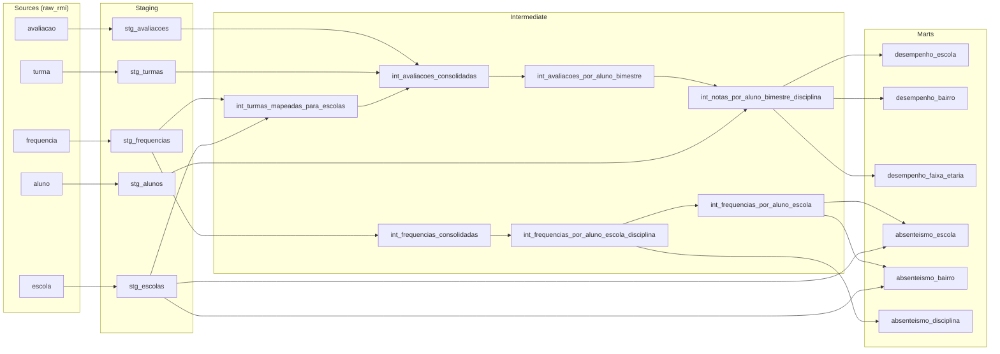

# Desafio RMI — Cientista de Dados

Projeto dbt-core + BigQuery sobre os dados educacionais anonimizados do RMI, em camadas staging → intermediate → marts, com indicadores de desempenho e de absenteísmo crônico. O enunciado original está em [ENUNCIADO.md](ENUNCIADO.md) e a análise dos resultados em [docs/relatorio-resultados.html](docs/relatorio-resultados.html).

## Como reproduzir

Pré-requisitos: Python com `dbt-core 1.12` e `dbt-bigquery 1.12` (`requirements.txt`), gcloud CLI (que traz o `bq`) e um projeto no BigQuery (o Sandbox basta).

### 1. Carregar os dados brutos

Os cinco Parquets estão em `gs://case_vagas/rmi`. O script `scripts/load_raw.ps1` os carrega no dataset `raw_rmi` (location `US`), sem transformação:

```powershell
gcloud auth login
gcloud auth application-default login
.\scripts\load_raw.ps1 -Project <seu-projeto>
```

O script faz três passos: cria o dataset (`bq mk --force`), carrega cada tabela (`bq load --replace --source_format=PARQUET`) e lista a contagem de linhas. A carga é idempotente: pode ser repetida sem duplicar dados. Contagens esperadas:

| Tabela | Linhas |
|---|---|
| `aluno` | 97.044 |
| `turma` | 97.044 |
| `escola` | 1.558 |
| `frequencia` | 2.727.684 |
| `avaliacao` | 221.687 |

O script é PowerShell; em Linux ou macOS, rode com `pwsh` ou execute os mesmos comandos à mão:

```bash
bq mk --force --location=US --dataset <seu-projeto>:raw_rmi
for t in aluno escola turma frequencia avaliacao; do
  bq load --project_id=<seu-projeto> --replace --source_format=PARQUET raw_rmi.$t gs://case_vagas/rmi/$t
done
```

No Sandbox as tabelas expiram em 60 dias; depois disso, basta rodar a carga de novo.

### 2. Rodar o dbt

O perfil do dbt se chama `rmi_educacao` (método `oauth`, location `US`).

```powershell
pip install -r requirements.txt
dbt deps
dbt build
```

## Estrutura do projeto

```
├── models/
│   ├── staging/educacao/   5 modelos (1 por tabela), sources.yml, schema.yml
│   ├── intermediate/       7 modelos, schema.yml
│   └── marts/              6 modelos com contrato, schema.yml
├── tests/                  testes singulares
│   └── generic/            testes genéricos customizados
├── macros/                 regras definidas uma única vez
├── scripts/load_raw.ps1    carga idempotente dos Parquets
├── notebooks/              i_perfilamento.ipynb (evidências do perfilamento)
├── docs/                   relatório de resultados
└── dbt_project.yml         materializações por camada e var do limite de 75%
```

Staging e intermediate são views; marts são tabelas. Nomes de modelos e colunas em português; chaves como STRING com o nome da fonte (`id_aluno`, `id_turma`, `id_escola`); booleanos com `eh_`, `possui_` e `foi_`.

## Perfilamento

O ***perfilamento (data profiling)*** dos dados foi realizado antes da construção dos modelos e orientou as principais decisões do projeto. Essa etapa é fundamental para compreender as características das fontes de dados que compõem o pipeline, além de identificar possíveis inconsistências e levantar indícios sobre os processos de extração. Esse entendimento é essencial para orientar a modelagem das entidades, identificar seus relacionamentos e definir heurísticas para o posterior tratamento e a transformação dos dados.

Para isso **comparei a documentação entregue para o desafio com as bases na camada raw**. As consultas que sustentam cada achado estão em [notebooks/i_perfilamento.ipynb](notebooks/i_perfilamento.ipynb).

| Tabela (`raw_rmi`) | Nº Linhas | Nº Colunas | Documentação do desafio | Encontrado no perfilamento | Problemas de qualidade |
|---|---:|---:|---|---|---|
| `aluno` | 97.044 | 4 | 1 linha por aluno | <ul><li>A granularidade confere;</li><li>`id_aluno` é BYTES, não STRING.</li></ul> | <ul><li>68 alunos sem bairro de residência;</li><li>Hash de bairro sem nenhum valor em comum com o de `escola`.</li></ul> |
| `turma` | 97.044 | 3 | 1 linha por turma, com série e turno | <ul><li>1 linha por aluno: a turma final do aluno;</li><li>`id_turma` igual a `aluno.id_turma` em 100% dos alunos;</li><li>`ano` constante (2000).</li></ul> | <ul><li>Sem série nem turno.</li></ul> |
| `escola` | 1.558 | 2 | Tipo e região | <ul><li>Só `id_escola` e bairro (hash).</li></ul> | <ul><li>Sem tipo nem região;</li><li>Só 521 das 1.558 escolas aparecem na `frequencia`, única tabela com `id_escola`;</li><li>Hash de bairro sem ligação com `datario.dados_mestres.bairro`.</li></ul> |
| `frequencia` | 2.727.684 | 7 | 1 linha por aluno/dia; percentual | <ul><li>Granularidade: aluno × turma × disciplina × período;</li><li>11 períodos, de 2000-02-05 a 2000-10-03 (ano anonimizado); a partir de 2000-07-18 restam menos de 1% dos alunos;</li><li>A coluna é calculada como `100 − faltas/dias letivos`: como as faltas vão de 0 ao total de dias letivos, o valor só pode ir de 99 (faltou todos os dias) a 100 (não faltou).</li></ul> | <ul><li>1.483 linhas idênticas;</li><li>1.093 casos em que o mesmo aluno, turma, disciplina e período aparecem com dois valores de frequência diferente;</li><li>1.857 registros (0,07%) abaixo de 99, o que indicaria mais faltas do que dias letivos;</li><li>O `id_aluno` não corresponde ao de `aluno`, ao contrário do que diz a documentação: só 11 de 97.044 alunos têm a mesma turma nas duas tabelas, e a correlação da frequência por aluno com a da `avaliacao` é próxima de zero.</li></ul> |
| `avaliacao` | 221.687 | 8 | 1 linha por aluno/disciplina/bimestre | <ul><li>Granularidade: aluno × turma × bimestre, com as notas em colunas;</li><li>`bimestre` é STRING, não INT64.</li></ul> | <ul><li>31 chaves aluno + turma + bimestre duplicadas;</li><li>538 pares aluno + bimestre em mais de uma turma;</li><li>Inglês 100% nulo;</li><li>27.542 alunos de `aluno` (28%) sem nenhuma avaliação.</li></ul> |

### Decisões

1. **Desempenho vem da `avaliacao`; absenteísmo vem da `frequencia`.** A `frequencia` cobre todos os alunos e traz a escola em cada registro. Como o seu `id_aluno` não corresponde ao da tabela `aluno`, o absenteísmo não é cruzado com faixa etária nem com notas por aluno.
2. **Escola da avaliação pelo mapa turma → escola.** A `avaliacao` não tem escola. A `frequencia` tem, e nela cada turma pertence a uma única escola; com isso, a escola de cada nota é obtida pela sua turma. Para verificar se esse vínculo não foi embaralhado na anonimização, usei os alunos que mudam de turma entre bimestres na `avaliacao`: 67% ficam na mesma escola segundo o mapa, contra cerca de 0,05% se as escolas tivessem sido atribuídas ao acaso.
3. **Duplicatas com valores divergentes não são escolhidas nem promediadas.** A coluna em conflito é anulada e marcada com uma flag; a linha é mantida.
4. **Registros de frequência abaixo de 99 são excluídos na staging** (0,06% da base). São impossíveis pela regra de cálculo da fonte. Ressalva: são os registros de maior falta.
5. **Unidade do absenteísmo: o vínculo aluno–escola.** O aluno que passou por duas escolas conta em cada uma. O indicador cobre só os períodos que a fonte traz (2000-02-05 a 2000-10-03, concentrados até 2000-07-17), não o ano letivo inteiro.
6. **Bairro recalculado a partir dos registros**, e não como média das escolas.
7. **Marts em formato tidy**, um por pergunta, com numerador e denominador expostos e registrados no `meta` do YAML.

## Linhagem



## Princípio do projeto: cada regra em um só lugar (DRY)

Cada regra é escrita uma única vez e as etapas seguintes só a reutilizam. Nenhum modelo reimplementa uma regra de outro, e testes de reconciliação conferem que os totais se mantêm de uma camada para a outra.

| Regra | Único lugar onde está escrita | Quem reutiliza |
|---|---|---|
| Remoção de linhas idênticas | macro `remover_linhas_identicas` | as 5 stagings |
| Conversão do `id_aluno` (BYTES → texto) | macro `formatar_id_aluno` | as 4 stagings com aluno |
| Consolidação de chaves duplicadas | macros `consolidar_valor` e `possui_conflito` | as 2 consolidações (avaliação e frequência) |
| Turma do aluno no bimestre | `int_avaliacoes_por_aluno_bimestre` | todos os marts de desempenho |
| Frequência em percentual | macro `percentual_frequencia` | os 2 modelos de frequência por aluno |
| Limite de 75% | var `percentual_frequencia_minima` + macro `abaixo_da_frequencia_minima` | os 2 modelos de frequência por aluno |
| Escola de cada turma | `int_turmas_mapeadas_para_escolas` | avaliação consolidada |

## Staging

Um modelo por tabela da fonte, sem joins nem agregações. A camada só tipa, renomeia e aplica filtros de validade, **mantendo a correspondência 1:1 com a *raw*** (um modelo para cada tabela), seguindo as boas práticas da [documentação oficial do dbt](https://docs.getdbt.com/best-practices/how-we-structure/2-staging). As regras de negócio, que exigem transformações que mudam de forma mais significativa a dimensão das bases, ficam para a camada [intermediate](https://docs.getdbt.com/best-practices/how-we-structure/3-intermediate).

| Modelo | Arquivo | Chave | Linhas (raw → staging) | O que faz |
|---|---|---|---:|---|
| `stg_educacao__alunos` | [stg_educacao__alunos.sql](models/staging/educacao/stg_educacao__alunos.sql) | `id_aluno` | 97.044 → 97.044 | <ul><li>`id_aluno` de BYTES para texto (macro `formatar_id_aluno`);</li><li>`id_turma` para texto;</li><li>`bairro` → `bairro_residencia`;</li><li>cria `ordem_faixa_etaria` (a ordem alfabética põe "11-14" antes de "6-10");</li><li>nenhuma linha idêntica.</li></ul> |
| `stg_educacao__turmas` | [stg_educacao__turmas.sql](models/staging/educacao/stg_educacao__turmas.sql) | `id_aluno` | 97.044 → 97.044 | <ul><li>`id_aluno` de BYTES para texto; `id_turma` para texto;</li><li>`ano` → `ano_letivo`;</li><li>nenhuma linha idêntica.</li></ul> |
| `stg_educacao__escolas` | [stg_educacao__escolas.sql](models/staging/educacao/stg_educacao__escolas.sql) | `id_escola` | 1.558 → 1.558 | <ul><li>`id_escola` para texto;</li><li>`bairro` → `bairro_escola`;</li><li>nenhuma linha idêntica.</li></ul> |
| `stg_educacao__frequencias` | [stg_educacao__frequencias.sql](models/staging/educacao/stg_educacao__frequencias.sql) | `id_aluno`, `id_turma`, `disciplina`, `data_inicio`, `data_fim` | 2.727.684 → 2.724.344 | <ul><li>remove 1.483 linhas idênticas;</li><li>remove 1.857 registros abaixo de 99;</li><li>`frequencia` → `indice_frequencia_fonte`;</li><li>cria `nome_disciplina` (`disciplina_1` → `portugues` etc.);</li><li>cria `faltas_por_dia_letivo` (`100 − frequencia`) e `duracao_periodo_dias`;</li><li>datas de texto para DATE; ids para texto.</li></ul> |
| `stg_educacao__avaliacoes` | [stg_educacao__avaliacoes.sql](models/staging/educacao/stg_educacao__avaliacoes.sql) | `id_aluno`, `id_turma`, `bimestre` | 221.687 → 221.684 | <ul><li>remove 3 linhas idênticas;</li><li>`disciplina_1` → `nota_portugues`;</li><li>`disciplina_2` → `nota_ciencias`;</li><li>`disciplina_3` → `nota_ingles`;</li><li>`disciplina_4` → `nota_matematica`;</li><li>`frequencia` → `percentual_frequencia_bimestre`;</li><li>`bimestre` de texto para inteiro; ids para texto.</li></ul> |

**O que foi feito**

- Chaves como texto em todas as tabelas, para os joins não dependerem de tipo;
- Linhas idênticas (cópias exatas em todas as colunas) são removidas em todas as stagings pela mesma macro, [`remover_linhas_identicas`](macros/remover_linhas_identicas.sql). Chaves repetidas com valores diferentes seguem para a intermediate, onde a regra de consolidação fica explícita.

**A chave da `avaliacao`:** O enunciado declara uma linha por aluno, disciplina e bimestre. Como as disciplinas vêm em colunas, isso equivale a aluno + bimestre. Testei as duas chaves candidatas:

| Chave testada | Combinações distintas | Chaves repetidas |
|---|---:|---:|
| `id_aluno`, `bimestre` (enunciado) | 221.106 | 569 |
| `id_aluno`, `id_turma`, `bimestre` (adotada) | 221.653 | 31 |

Das 569 repetições da chave do enunciado, 538 são alunos que aparecem em mais de uma turma no mesmo bimestre, e cada turma traz o seu próprio registro: em 165 dos 185 pares com nota em duas turmas, as notas são diferentes. Dessa forma, comprovo que não são cópias e, portanto, juntá-las na staging exigiria escolher entre valores, o que é regra de negócio. Com a turma na chave, esses registros ficam preservados e restam 31 repetições de fato, tratadas na intermediate. Os dois testes continuam na staging como aviso, para a divergência com o enunciado ficar visível a cada execução.

**Regras de negócio**

| Regra | Como é garantida |
|---|---|
| A frequência da fonte fica entre 99 e 100 (`100 − faltas/dias letivos`) | filtro na staging; teste de faixa (`error`); teste de monitoramento na source (`warn`) |
| Cada turma pertence a uma única escola | teste `valor_unico_por_grupo` |
| A turma final do aluno é a mesma em `aluno` e `turma` | teste `regra_turma_final_consistente` |
| Todos os registros são de um único ano letivo | `accepted_values` em `ano_letivo`; teste do ano nas datas da frequência |

**Testes** (45 genéricos e 2 singulares)

- Chaves: `unique` e `not_null`; `unique_combination_of_columns` nas chaves compostas.
- Domínios: `accepted_values` em faixa etária, bimestre e disciplina.
- Integridade: `relationships` de avaliação, turma e frequência para aluno, e de frequência para escola.
- Faixas: notas de 0 a 10; frequência da avaliação de 0 a 100; índice da frequência de 99 a 100.
- Premissas da fonte: Inglês 100% nulo (avisa se passar a ter valor); ao menos 95% de frequência preenchida na avaliação.

## Intermediate

Onde ficam as regras de negócio: consolidação de duplicatas, joins entre fontes e mudanças de granularidade.

| Modelo | Arquivo | Chave | Linhas | O que faz |
|---|---|---|---:|---|
| `int_turmas_mapeadas_para_escolas` | [int_turmas_mapeadas_para_escolas.sql](models/intermediate/int_turmas_mapeadas_para_escolas.sql) | `id_turma` | 5.516 | <ul><li>mapa turma → escola → bairro, a partir da frequência.</li></ul> |
| `int_avaliacoes_consolidadas` | [int_avaliacoes_consolidadas.sql](models/intermediate/int_avaliacoes_consolidadas.sql) | `id_aluno`, `id_turma`, `bimestre` | 221.653 | <ul><li>consolida as 31 chaves repetidas;</li><li>traz escola e bairro (mapa) e a turma final.</li></ul> |
| `int_avaliacoes_por_aluno_bimestre` | [int_avaliacoes_por_aluno_bimestre.sql](models/intermediate/int_avaliacoes_por_aluno_bimestre.sql) | `id_aluno`, `bimestre` | 221.106 | <ul><li>atribui uma turma ao aluno no bimestre.</li></ul> |
| `int_notas_por_aluno_bimestre_disciplina` | [int_notas_por_aluno_bimestre_disciplina.sql](models/intermediate/int_notas_por_aluno_bimestre_disciplina.sql) | `id_aluno`, `bimestre`, `disciplina` | 558.039 | <ul><li>unpivot: uma linha por nota existente;</li><li>traz a faixa etária.</li></ul> |
| `int_frequencias_consolidadas` | [int_frequencias_consolidadas.sql](models/intermediate/int_frequencias_consolidadas.sql) | `id_aluno`, `id_turma`, `disciplina`, `data_inicio`, `data_fim` | 2.723.254 | <ul><li>consolida as 1.090 chaves repetidas.</li></ul> |
| `int_frequencias_por_aluno_escola_disciplina` | [int_frequencias_por_aluno_escola_disciplina.sql](models/intermediate/int_frequencias_por_aluno_escola_disciplina.sql) | `id_aluno`, `id_escola`, `disciplina` | 402.550 | <ul><li>soma faltas e dias dos períodos;</li><li>calcula a frequência em percentual.</li></ul> |
| `int_frequencias_por_aluno_escola` | [int_frequencias_por_aluno_escola.sql](models/intermediate/int_frequencias_por_aluno_escola.sql) | `id_aluno`, `id_escola` | 100.640 | <ul><li>soma as disciplinas;</li><li>calcula a frequência global do vínculo aluno–escola.</li></ul> |

**O que foi feito**

- Join `left` sempre que a outra tabela pode não ter correspondência, para não perder registros: turma fora do mapa fica com escola nula (cobertura de 81% das avaliações) em vez de sumir.
- A frequência não é ligada a `aluno` nem à `avaliacao`, porque o seu `id_aluno` não corresponde ao das outras tabelas. Ela só é agregada dentro dela mesma, por escola e disciplina.
- Faltas e dias são somados antes de calcular o percentual, para não fazer média de médias.

**Regras de negócio**

| Regra | Definição |
|---|---|
| Consolidação | Na mesma chave, valor único é mantido; valores diferentes viram nulo e uma flag (`possui_conflito_*`). Nunca se escolhe um valor nem se tira média |
| Turma do aluno no bimestre | (1) turma única; (2) a única turma com nota; (3) sem nota, a única com frequência. Nos demais casos não há atribuição: `possui_conflito_turma` (283 dos 538 pares em várias turmas) |
| Frequência em percentual | `100 × (1 − soma das faltas / soma dos dias)`, com a duração do período como peso |
| Absenteísmo crônico | frequência abaixo de 75% (LDB, art. 24, VI) |

**Testes** (49 genéricos e 1 singular)

- Granularidade de cada modelo com severidade `error`: aqui uma duplicata é erro da transformação, não da fonte.
- Coerência das flags: conflito implica valor nulo; conflito de turma coincide com a regra de atribuição.
- Reconciliação com a origem: `compara_linhas_com_origem` (nenhuma linha da staging perdida ou contada duas vezes), `soma_reconcilia_com` e `reconciliacao_pares_aluno_bimestre`.
- Integridade: `relationships` para aluno e escola; unicidade do mapa turma → escola.

## Marts

Tabelas em formato tidy, uma por pergunta. Os marts só agregam: nenhuma regra nova é criada nesta camada.

| Mart | Arquivo | Chave | Linhas | Indicador | Numerador / denominador |
|---|---|---|---:|---|---|
| `mart_educacao__desempenho_escola` | [mart_educacao__desempenho_escola.sql](models/marts/mart_educacao__desempenho_escola.sql) | `id_escola`, `disciplina` | 1.425 | média das notas | soma das notas / notas existentes |
| `mart_educacao__desempenho_bairro` | [mart_educacao__desempenho_bairro.sql](models/marts/mart_educacao__desempenho_bairro.sql) | `bairro_escola`, `disciplina` | 402 | média das notas | idem |
| `mart_educacao__desempenho_faixa_etaria` | [mart_educacao__desempenho_faixa_etaria.sql](models/marts/mart_educacao__desempenho_faixa_etaria.sql) | `faixa_etaria`, `disciplina` | 9 | média das notas | idem |
| `mart_educacao__absenteismo_escola` | [mart_educacao__absenteismo_escola.sql](models/marts/mart_educacao__absenteismo_escola.sql) | `id_escola` | 521 | taxa de absenteísmo crônico | alunos abaixo de 75% / alunos com frequência na escola |
| `mart_educacao__absenteismo_bairro` | [mart_educacao__absenteismo_bairro.sql](models/marts/mart_educacao__absenteismo_bairro.sql) | `bairro_escola` | 135 | taxa de absenteísmo crônico | vínculos abaixo de 75% / vínculos aluno–escola |
| `mart_educacao__absenteismo_disciplina` | [mart_educacao__absenteismo_disciplina.sql](models/marts/mart_educacao__absenteismo_disciplina.sql) | `disciplina` | 4 | taxa de absenteísmo crônico | vínculos abaixo de 75% na disciplina / vínculos na disciplina |

**O que foi feito**

- Numerador e denominador ficam em colunas e no `meta` do YAML, para a taxa poder ser conferida.
- O bairro é recalculado a partir dos registros, e não como média das escolas.
- A unidade do desempenho é a nota do aluno no bimestre; a do absenteísmo é o vínculo aluno–escola (quem passou por duas escolas conta em cada uma).
- Cobertura: 521 das 1.558 escolas têm frequência; 475 têm notas atribuídas. Só três faixas etárias têm notas.

**Regras de negócio.** As mesmas da intermediate, sem reimplementação: os marts leem a flag `possui_absenteismo_cronico` e a turma já atribuída.

**Testes** (45 genéricos)

- Contrato de nomes e tipos de coluna nos 6 marts.
- Chaves únicas e não nulas; `relationships` para escola.
- Faixas: taxas de 0 a 1; médias de 0 a 10; frequência de 0 a 100.
- Reconciliação: os totais de bairro batem com os de escola, e os de cada mart batem com a intermediate (`soma_reconcilia_com`).

## Resultado dos testes

São 142 testes de dados; o último `dbt build` terminou com PASS=155, WARN=5, ERROR=0. A severidade segue um critério: `error` para o que invalida o dado ou indica erro da transformação; `warn` para problemas conhecidos da fonte, monitorados em uma camada e tratados na seguinte. Os 5 avisos são esses monitoramentos:

| Aviso | Linhas | Tratamento |
|---|---:|---|
| Frequência abaixo de 99 na fonte | 1.857 | Excluídas na staging |
| Aluno + bimestre não é único na `avaliacao` | 569 | Consolidação e regra de atribuição de turma |
| Chaves repetidas na `avaliacao` | 31 | Consolidação |
| Chaves repetidas na `frequencia` | 1.090 | Consolidação |
| Bairro de residência nulo | 68 | Coluna sem uso nos indicadores |

## Limites e próximos passos

Os dados são aleatorizados, então os resultados ilustram o método e não descrevem a rede. O absenteísmo cobre só os períodos da fonte (2000-02-05 a 2000-10-03, concentrados até 2000-07-17) e usa dias corridos como aproximação dos dias letivos. Os indicadores por escola e bairro alcançam 521 das 1.558 escolas. Com mais tempo, eu acrescentaria CI com `dbt build` no GitHub Actions, teste unitário da regra de atribuição de turma e `freshness` nas sources.
